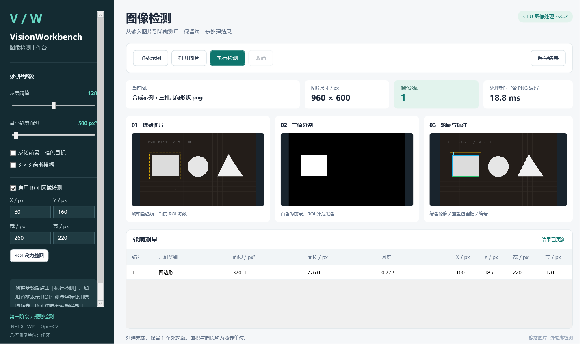

# VisionWorkbench

WPF 静态图片检测工作台，面向 .NET/WPF 与机器视觉应用学习。当前版本 v0.2 支持图片加载、阈值分割、ROI 区域检测、外轮廓过滤、几何测量、后台处理与 PNG / JSON 导出。

代码采用 AI 辅助方式实现，依据实际源码、编译结果和验证记录整理。

## 系列文章

- [实战（1）：做一个可复现的图片检测工作台](docs/blog-01.md) · [CSDN 文章](https://blog.csdn.net/weixin_45788360/article/details/167919864)。
- [实战（2）：后台图像处理、跨线程图片与取消机制](docs/blog-02.md) · 已完成备稿，尚未提交 CSDN。
- [ROI 使用与验证](docs/roi/README.md)：v0.2 已实现数值设置区域、原图 ROI 框、坐标还原及导出元数据。
- [后续功能与内容计划](docs/content-plan.md)：接下来逐步接入分割改进、批处理、PyTorch 与 ONNX。

第一、二篇源码分析固定参考 v0.1 的 `57098b9` 提交，可下载 [v0.1 示例源码](https://github.com/hejianmin02-wq/VisionWorkbench/archive/57098b9c496c4d24584fd2281b8b1cc2eb90ee95.zip)；后续实现文章使用对应版本的固定链接。

## 历史界面与样例

以下两张保留 v0.1 的展示与说明；v0.2 当前界面见下方 ROI 区域检测。


合成样例包含三个大形状和五个微小噪点。阈值 128、最小面积 500 时保留三个轮廓。


复杂照片截图由使用者提供：图片尺寸 787×733，阈值 128，最小面积 500，输出 13 个外轮廓。轮廓表示当前分割条件下的前景边界；几何类别来自边界近似规则。截图中的 54.2 ms 是单次显示值，本仓库未取得该照片原始文件，不将截图用作准确率或性能基准。

## v0.2 ROI 区域检测



加载示例后，勾选“启用 ROI 区域检测”，输入 `X=80`、`Y=160`、`宽=260`、`高=220`，再执行检测。该区域保留一个矩形，表格中的包围框原图坐标为 `(100,185)`，尺寸为 `220×170`。

ROI 使用原图像素坐标。二值图保持原图尺寸，区域外为黑色；原始 PNG 保持输入内容，原图视图中的虚线框为当前 ROI 参数。ROI 边界会截断跨界目标，测量值描述截取后的形状。

非法输入会禁用检测与保存；修改 ROI 后需要与结果参数重新一致才能保存。“ROI 设为整图”使用当前图片实际尺寸。本版使用数值输入，鼠标拖拽选区尚未实现。导出 JSON 使用 SchemaVersion 2，记录区域与原图坐标约定。

## 开发与运行

本次在 Windows x64、.NET SDK 9.0.317 下编译，WPF 目标为 net8.0-windows。依赖版本已经写入各项目文件。

需要 Windows x64、兼容 .NET SDK 和 .NET 8 Windows Desktop Runtime。OpenCvSharp4 与 Windows native runtime 固定为 4.9.0.20240103。首次还原依赖需要 NuGet 网络或已有缓存。

```powershell
dotnet build VisionWorkbench.sln --configuration Release
dotnet run --project src/VisionWorkbench.Desktop/VisionWorkbench.Desktop.csproj --configuration Release
```

## 项目

- Core：图片处理、参数、测量与导出。
- Desktop：WPF / MVVM 界面及桌面流程检查。
- Tests：xUnit 算法与导出行为用例。
- Verify：为当前同步 Fact/InlineData 用例提供单进程断言执行入口。

## 使用

1. 点击“加载示例”或“打开图片”。
2. 调整阈值、最小轮廓面积、前景反转及高斯模糊。
3. 点击“执行检测”，对照原图、二值图、标注图和测量表。
4. 点击“保存结果”，导出标注图、二值图与测量 JSON。

参数变更后需要重新处理才能保存。面积与周长为像素单位；物理尺寸测量需要标定。本版尚未接入相机或 PyTorch 模型。

## 验证

标准测试命令：

```powershell
dotnet test tests/VisionWorkbench.Tests/VisionWorkbench.Tests.csproj --configuration Release
```

v0.2 Release 构建成功，0 警告、0 错误。单进程算法断言 36 项通过，发布目录中的桌面程序通过 21 项流程检查，WPF 绑定错误日志为空。标准 VSTest 运行等待 testhost 连接 90 秒后中止，未记为通过。具体范围与命令见 [ROI 验证记录](docs/roi/README.md)，v0.1 历史记录保留在 [原验证记录](docs/验证记录.md)。

```powershell
dotnet run --project tools/VisionWorkbench.Verify/VisionWorkbench.Verify.csproj --configuration Release -- artifacts/verification
```

代码采用 AI 辅助方式实现。学习时建议沿着 MainViewModel → ImageProcessor → ProcessingResult → WPF 绑定，完成一次实际修改并复现结果。

## 第三方组件

OpenCvSharp 和测试依赖通过 NuGet 还原。仓库保存项目源码、示例图与验证记录，不包含已还原的依赖、bin/obj 或桌面运行包。依赖说明见 [THIRD_PARTY.md](THIRD_PARTY.md)。
