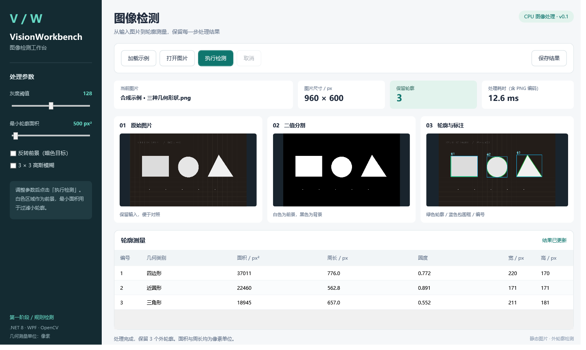
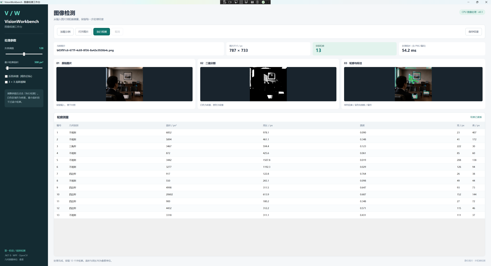

# VisionWorkbench

WPF 静态图片检测工作台，面向 .NET/WPF 与机器视觉应用学习。当前版本 v0.1 支持图片加载、阈值分割、外轮廓过滤、几何测量、后台处理与 PNG / JSON 导出。

代码采用 AI 辅助方式实现，依据实际源码、编译结果和验证记录整理。

## 界面与样例



合成样例包含三个大形状和五个微小噪点。阈值 128、最小面积 500 时保留三个轮廓。



复杂照片截图由使用者提供：图片尺寸 787×733，阈值 128，最小面积 500，输出 13 个外轮廓。轮廓表示当前分割条件下的前景边界；几何类别来自边界近似规则。截图中的 54.2 ms 是单次显示值，本仓库未取得该照片原始文件，不将截图用作准确率或性能基准。

## 开发与运行

本次在 Windows x64、.NET SDK 9.0.317 下编译，WPF 目标为 net8.0-windows。依赖版本已经写入各项目文件。

需要 Windows x64、兼容 .NET SDK 和 .NET 8 Windows Desktop Runtime。OpenCvSharp4 与 Windows native runtime 固定为 4.9.0.20240103。首次还原依赖需要 NuGet 网络或已有缓存。

```powershell
dotnet build VisionWorkbench.sln --configuration Release
dotnet run --project src/VisionWorkbench.Desktop/VisionWorkbench.Desktop.csproj --configuration Release
```

## 项目

- Core：图片处理、参数、测量与导出。
- Desktop：WPF / MVVM 界面及桌面流程检查。
- Tests：xUnit 算法与导出行为用例。
- Verify：为当前同步 Fact/InlineData 用例提供单进程断言执行入口。

## 使用

1. 点击“加载示例”或“打开图片”。
2. 调整阈值、最小轮廓面积、前景反转及高斯模糊。
3. 点击“执行检测”，对照原图、二值图、标注图和测量表。
4. 点击“保存结果”，导出标注图、二值图与测量 JSON。

参数变更后需要重新处理才能保存。面积与周长为像素单位；物理尺寸测量需要标定。本版尚未接入相机或 PyTorch 模型。

## 验证

标准测试命令：

```powershell
dotnet test tests/VisionWorkbench.Tests/VisionWorkbench.Tests.csproj --configuration Release
```

制作环境中 VSTest 与 testhost 的通信被限制，标准运行中止。单进程算法断言 15 项通过、桌面流程检查 8 项通过；具体范围与局限见 [验证记录](docs/验证记录.md)。

```powershell
dotnet run --project tools/VisionWorkbench.Verify/VisionWorkbench.Verify.csproj --configuration Release -- artifacts/verification
```

代码采用 AI 辅助方式实现。学习时建议沿着 MainViewModel → ImageProcessor → ProcessingResult → WPF 绑定，完成一次实际修改并复现结果。

## 第三方组件

OpenCvSharp 和测试依赖通过 NuGet 还原。仓库保存项目源码、示例图与验证记录，不包含已还原的依赖、bin/obj 或桌面运行包。依赖说明见 [THIRD_PARTY.md](THIRD_PARTY.md)。
