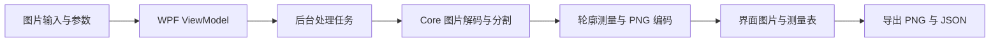
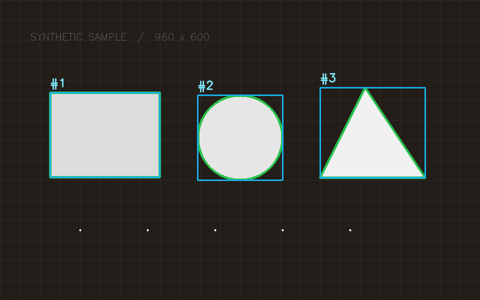

# WPF + OpenCvSharp 实战（1）：做一个可复现的图片检测工作台

@[TOC](目录)

将图像处理算法接入 WPF 时，除了算法输出，还需要考虑界面响应、中间图展示、资源释放以及结果保存。本篇从一个静态图片工作台开始，把图片输入、阈值分割、轮廓测量和结果导出接成完整流程。

项目名为 **VisionWorkbench**，当前版本是 v0.1。代码采用 AI 辅助方式实现，本文依据当前源码与实际编译、行为验证记录整理。涉及相机、标定和深度学习模型的部分将在后续迭代中加入。

## 1. 第一版完成了什么

当前版本支持 PNG、JPG、BMP 图片输入，提供可复现的合成示例，并在界面中并排显示原图、二值图和标注图。

左侧可以调整灰度阈值、最小轮廓面积、前景反转和 3×3 高斯模糊。点击“执行检测”后，下方表格显示轮廓面积、周长、圆度与包围框尺寸。“保存结果”会同时写出标注 PNG、二值 PNG 和测量 JSON。


上图来自真实 WPF 窗口可视树的离屏渲染。

## 2. 本次使用的环境

| 项目                       | 版本或设置          |
| ------------------------ | -------------- |
| 系统与架构                    | Windows x64    |
| .NET SDK                 | 9.0.317        |
| WPF 目标框架                 | net8.0-windows |
| 核心库目标框架                  | net8.0         |
| OpenCvSharp4             | 4.9.0.20240103 |
| OpenCvSharp4.runtime.win | 4.9.0.20240103 |

这些版本基于当前已有环境固定，方便复现。OpenCvSharp 的托管包和平台原生包需要配套使用，可以分别查看 [托管包页面](https://www.nuget.org/packages/OpenCvSharp4/4.9.0.20240103)和 [Windows runtime 页面](https://www.nuget.org/packages/OpenCvSharp4.runtime.win/4.9.0.20240103)。

## 3. 将算法与界面状态分开

项目核心分为两部分：



处理服务接收编码后的图片字节和参数对象，返回测量值与三张 PNG 的字节数组。服务内部创建的 `Mat` 在处理结束后释放，界面层接收托管结果。

采用 PNG 作为两个模块之间的图像交换格式，优点是结果易于保存、检查和跨线程传递。代价是编码和额外内存分配，所以界面显示的处理耗时也包含 PNG 编码。本版先明确行为，实时视频阶段再评估更直接的图像缓冲区传递方式。

## 4. 阈值分割与外轮廓提取

以下是处理服务中的关键片段，变量来自完整服务方法：

```csharp
using var source = Cv2.ImDecode(encodedImage, ImreadModes.Color);
using var gray = new Mat();
using var binary = new Mat();

Cv2.CvtColor(source, gray, ColorConversionCodes.BGR2GRAY);

if (parameters.Blur)
    Cv2.GaussianBlur(gray, gray, new Size(3, 3), 0);

Cv2.Threshold(
    gray, binary, parameters.Threshold, 255,
    parameters.Invert
        ? ThresholdTypes.BinaryInv
        : ThresholdTypes.Binary);

Cv2.FindContours(
    binary, out Point[][] contours, out _,
    RetrievalModes.External,
    ContourApproximationModes.ApproxSimple);
```

正向二值化将严格大于阈值的灰度值设为 255，其余设为 0。如果目标比背景暗，可以使用反向二值化，仍让目标成为白色前景。对应语义见 [OpenCV 阈值处理文档](https://docs.opencv.org/4.x/d7/d4d/tutorial_py_thresholding.html)。

本版选择外轮廓，适合先观察独立物体的外部边界。存在孔洞的目标需要进一步处理轮廓层级，不能直接将外轮廓面积当作扣除孔洞后的净面积。

过滤阶段使用 `Cv2.ContourArea`，保留面积大于等于最小面积、且面积大于零的轮廓。之后按包围框的 X、Y 坐标排序，再编号，这让同一张样例的结果顺序保持一致。

## 5. 为什么 220×170 的矩形，面积是 37011

默认合成图大小为 960×600，包含三个大形状和五个半径为 2 的小噪点。阈值 128、最小面积 500 时，实际结果如下：

| 编号  | 几何类别 | 轮廓面积 / px² | 包围框宽×高 / px |
| --- | ---- | ----------:| ----------- |
| 1   | 四边形  | 37011      | 220×170     |
| 2   | 近圆形  | 22460      | 171×171     |
| 3   | 三角形  | 18945      | 211×181     |



矩形的包围框尺寸是 220×170，但轮廓边界点的坐标跨度是 219×169，乘积为 37011。包围框面积、白色像素数量和轮廓几何面积有不同的含义。

项目中还验证了一个更小的例子：16×16 的实心矩形，其轮廓面积是 225。最小面积设置为 225 时保留，设置为 226 时过滤。这个用例能够检查实现是否错误地使用了包围框面积。

轮廓测量方法可参考 [OpenCV 轮廓特征文档](https://docs.opencv.org/4.x/dd/d49/tutorial_py_contour_features.html)。本版的面积和周长使用像素单位；换算为毫米需要标定条件。

### 5.1 复杂照片中的分割结果

接着加载一张室内照片，观察算法在背景和纹理更复杂时的输出。下面是实际操作截图，输入图片尺寸为 787×733，阈值为 128，最小轮廓面积为 500，保留了 13 个外轮廓。


从二值图和标注图可以看到，窗边、画框、桌面和显示器附近的亮度区域形成了不同大小的前景。场景的光照、反光和背景纹理，会共同影响分割边界。

这里的 13 个轮廓表示当前参数下的外部前景边界。场景中的一个物体可能形成多个轮廓，多个区域也可能连成一个轮廓；表格里的“三角形”“四边形”来自边界近似与圆度规则，不具有物体类别识别的含义。

这张截图适合用来提出下一步改进问题：如果只关心桌面中的一块区域，应先定义 ROI；如果目标区域内照明变化明显，可以比较固定阈值和自适应阈值；如果需要识别具体物体类别，则需要另行设计特征方法或模型。

截图中的 54.2 ms 是该次操作显示的处理耗时。本文没有该照片的原始文件和独立测量记录，因此这里只引用截图所显示的观察值，不把它作为性能基准或算法准确率证据。

## 6. WPF 中的后台处理与图片加载

处理前，ViewModel 保存本次参数快照，进入忙碌状态，再通过 `Task.Run` 执行 CPU 图像处理。用户在任务完成后得到这一组参数对应的结果。

WPF 图片对象在后台创建后冻结，再交给界面线程更新。转换方法如下：

```csharp
public static BitmapSource FromPng(byte[] bytes)
{
    using var stream = new MemoryStream(bytes);
    var image = new BitmapImage();
    image.BeginInit();
    image.CacheOption = BitmapCacheOption.OnLoad;
    image.StreamSource = stream;
    image.EndInit();
    image.Freeze();
    return image;
}
```

这里使用 `OnLoad` 在初始化时加载图像，之后才能关闭输入流；`Freeze()` 让这个图像对象成为可跨线程共享的冻结对象。背景任务完成后，绑定属性和 `ObservableCollection` 在界面线程中更新。线程安排参考 [WPF 官方线程模型](https://learn.microsoft.com/en-us/dotnet/desktop/wpf/advanced/threading-model)。

## 7. 让参数与导出结果保持一致

用户调整阈值后，界面仍可以显示上一次的结果，但会提示“参数已改变，请重新检测”，并禁用保存。判断依据是当前参数是否等于结果记录中的参数：

```csharp
public bool CanSave =>
    _result is not null &&
    _result.Parameters == SnapshotParameters();
```

新的结果完整生成后，界面才替换图片、测量表和参数记录。加载不存在或无法解码的图片时，会显示错误原因，并保留上一组成功结果。

导出的 JSON 包含参数、图片尺寸、测量值和单位，便于回看某张标注图到底由哪些设置生成。

## 8. 本次实际验证到了哪里

Release 构建成功，0 警告、0 错误。单进程验证入口执行了当前同一组 xUnit 同步断言，15 个用例全部通过，覆盖阈值边界、面积过滤、反向前景、空图、非法输入、预取消、PNG 编码和 JSON 导出。

标准 `dotnet test` 也进行了尝试，但运行环境阻止 VSTest 与 testhost 的本机通信，返回 SocketException 10013，测试运行中止。因此这里的 15 项通过是单进程断言验证的结果，没有将标准适配器运行记为成功。

桌面流程检查的 8 个检查点全部通过，并生成了本文配图。WPF 绑定错误日志为空。文件选择与保存对话框的人工交互、不同 DPI 的布局还需要在目标机器补充检查。

界面耗时是单次处理观察值，包含图片解码、OpenCV 运算和 PNG 编码，不包含文件读取与 WPF 渲染。它尚不能用于比较硬件性能或宣称实时检测帧率。

## 9. 获取完整源码并运行

完整源码、示例图片与验证记录已放到公开仓库：[VisionWorkbench](https://github.com/hejianmin02-wq/VisionWorkbench)。可以使用仓库的 **Code → Download ZIP** 下载，或直接下载 [本文 v0.1 源码 ZIP](https://github.com/hejianmin02-wq/VisionWorkbench/archive/57098b9c496c4d24584fd2281b8b1cc2eb90ee95.zip)。

下载后解压，在 Windows x64 环境中，用 Visual Studio 打开 `VisionWorkbench.sln`，将 `VisionWorkbench.Desktop` 设为启动项目。需要兼容的 .NET SDK 与 .NET 8 Windows Desktop Runtime，首次构建需要还原 NuGet 依赖。也可以在解决方案目录执行：

```powershell
dotnet build VisionWorkbench.sln --configuration Release
dotnet run --project src/VisionWorkbench.Desktop/VisionWorkbench.Desktop.csproj --configuration Release
```

建议依次阅读 [MainViewModel.cs](https://github.com/hejianmin02-wq/VisionWorkbench/blob/57098b9c496c4d24584fd2281b8b1cc2eb90ee95/src/VisionWorkbench.Desktop/MainViewModel.cs)、[ImageProcessor.cs](https://github.com/hejianmin02-wq/VisionWorkbench/blob/57098b9c496c4d24584fd2281b8b1cc2eb90ee95/src/VisionWorkbench.Core/ImageProcessor.cs) 和 [ProcessingModels.cs](https://github.com/hejianmin02-wq/VisionWorkbench/blob/57098b9c496c4d24584fd2281b8b1cc2eb90ee95/src/VisionWorkbench.Core/ProcessingModels.cs)。[验证记录](https://github.com/hejianmin02-wq/VisionWorkbench/blob/57098b9c496c4d24584fd2281b8b1cc2eb90ee95/docs/%E9%AA%8C%E8%AF%81%E8%AE%B0%E5%BD%95.md) 说明了本次实际检查范围及运行限制。

仓库中的合成图可以直接复现。复杂场景部分提供本文截图；该照片原始文件没有包含在仓库中。

## 10. 接下来可以怎样扩展

下一步准备加入更多真实样例，记录固定阈值在光照变化、目标粘连和背景纹理下的失败情况，再决定是否加入形态学操作、自适应阈值与 ROI。

深度学习阶段计划用 PyTorch 训练一个小型分类模型，通过 ONNX 部署到 C#。在接入之前，需要先把数据划分、颜色通道、缩放、归一化和张量排列约定清楚。

读者可以先做两个小练习：将阈值调到 255 观察前景清空；给测量表增加 X、Y 两列，显示已有的包围框坐标。这样能沿着参数、处理服务和界面绑定，走完一次完整修改。


