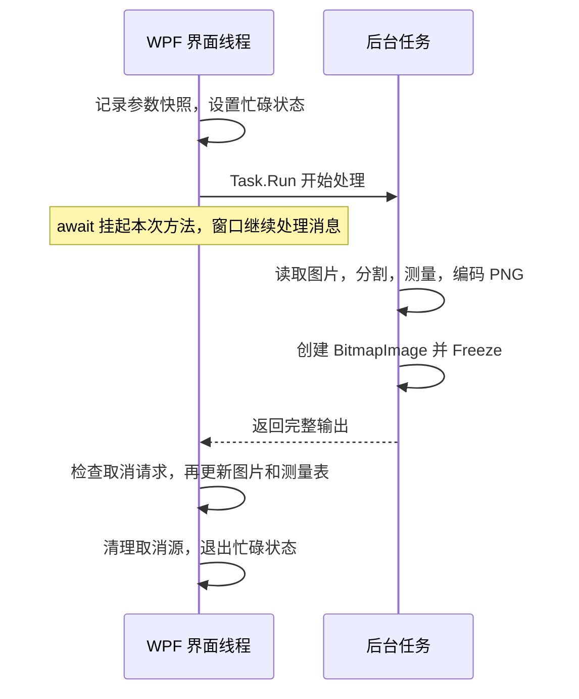

# WPF + OpenCvSharp 实战（2）：后台图像处理、跨线程图片与取消机制

@[TOC](目录)

把 OpenCV 算法接入 WPF 后，一次检测包含图片读取、解码、分割、轮廓测量、图片编码和界面更新。怎样安排这些工作，决定了窗口能否继续响应，以及界面上的图片、表格与导出文件能否保持一致。

本文继续拆解 VisionWorkbench v0.1 的实际实现，回答四个问题：耗时计算放在哪里，后台生成的图片怎样交给 WPF，取消为什么需要检查点，以及参数改变后为什么需要禁用保存。

代码采用 AI 辅助方式实现。本文依据已有源码与 2026-10-14 的验证记录整理，本篇没有新增性能实验，也没有把下面的排查示例写成已经发生过的项目故障。

完整项目：[VisionWorkbench](https://github.com/hejianmin02-wq/VisionWorkbench)。前篇：[做一个可复现的图片检测工作台](https://blog.csdn.net/weixin_45788360/article/details/167919864)。本文代码对应 [v0.1 源码提交](https://github.com/hejianmin02-wq/VisionWorkbench/tree/57098b9c496c4d24584fd2281b8b1cc2eb90ee95)。

## 1. 先划清后台与界面的边界

当前版本在 Windows x64、.NET SDK 9.0.317 下构建，目标框架为 `net8.0-windows`，OpenCvSharp4 与 Windows runtime 都固定为 `4.9.0.20240103`。


这张图沿用前篇的实际 WPF 离屏渲染，展示当前工作台布局。它可以说明界面组成，不能证明输入响应时间或取消延迟。

| 工作 | 当前执行位置 | 原因 |
|---|---|---|
| 文件选择对话框、读取界面参数 | UI 线程 | 处理用户交互，并固定本次参数 |
| 文件读取、OpenCV 处理、PNG 编码 | `Task.Run` 的后台委托 | 执行同步读取和 CPU 图像计算 |
| 从 PNG 创建三张图片并冻结 | 同一个后台委托 | 完成解码与可共享的图片对象准备 |
| 绑定属性赋值、测量集合更新、命令状态通知 | UI 线程 | 提交一组完整结果，更新界面 |

处理服务返回 PNG 字节数组和测量值，服务内部的 `Mat` 使用 `using` 释放。界面不会持有后台算法内部的原生 `Mat`。



## 2. async 方法里的同步计算仍然需要安排线程

下面是用于解释问题的反例，**不是项目当前实现**：

```csharp
private async Task ProcessOnUiAsync()
{
    // 假定从 UI 线程调用，这段同步运算仍占用 UI 线程。
    var result = _processor.Process(_input!, SnapshotParameters());
    await Task.CompletedTask;
}
```

关键在于同步计算发生在哪里。给方法加上 `async`，或在计算后等待一个已经完成的任务，都没有把前面的算法移到后台。

项目的实际入口是 `MainViewModel.ExecuteProcessingAsync`。以下摘录省略了结果提交、异常处理和清理部分：

```csharp
var parameters = SnapshotParameters();
_cancellation = new CancellationTokenSource();
var token = _cancellation.Token;
IsBusy = true;
Status = "正在处理图片…";

var output = await Task.Run(() =>
{
    var input = load();
    var result = _processor.Process(input, parameters, token);
    return (Input: input, Result: result,
        Original: ImageConversion.FromPng(result.OriginalPng),
        Binary: ImageConversion.FromPng(result.BinaryPng),
        Annotated: ImageConversion.FromPng(result.AnnotatedPng));
}, token);
```

`Task.Run` 把这里的同步处理安排到线程池。UI 线程通过 `await` 等待结果，而不在事件处理中使用 `.Wait()` 或 `.Result` 阻塞等待。线程与等待方式的关系可参考 [WPF 官方线程模型](https://learn.microsoft.com/en-us/dotnet/desktop/wpf/advanced/threading-model)。

本项目由 UI 命令调用这个方法，保留 WPF 同步上下文，因此 `await` 后面的结果提交会回到 UI 线程。这依赖调用位置；将这个公开方法从其他后台线程直接调用，并不能自动获得同样的保证。

## 3. OnLoad 和 Freeze 分别解决什么问题

后台处理结束时，算法输出的是字节数组；WPF 的 `Image.Source` 需要图片对象。项目的转换方法如下：

```csharp
public static BitmapSource FromPng(byte[] bytes)
{
    using var stream = new MemoryStream(bytes);
    var image = new BitmapImage();
    image.BeginInit();
    image.CacheOption = BitmapCacheOption.OnLoad;
    image.StreamSource = stream;
    image.EndInit();
    image.Freeze();
    return image;
}
```

这里需要分别考虑流的生命周期与图片的线程访问。

`OnLoad` 让图片在初始化阶段完成加载，然后方法可以释放 `MemoryStream`。如果仍采用按需读取，就不能仅凭 `EndInit()` 认为后续已经不需要输入流。见 [BitmapImage.CacheOption 官方说明](https://learn.microsoft.com/en-us/dotnet/api/system.windows.media.imaging.bitmapimage.cacheoption?view=windowsdesktop-9.0)。该属性用于本文目标框架，文档链接采用可访问的 Windows Desktop 9.0 视图。

`BitmapImage` 是可冻结对象。冻结后的对象不能继续修改，并可以跨线程共享，所以后台创建的图片能够作为结果交给 UI。`Freeze()` 不会把整个 ViewModel 或所有 WPF 控件都变成线程安全对象。规则见 [Freezable 官方说明](https://learn.microsoft.com/en-us/dotnet/desktop/wpf/advanced/freezable-objects-overview)。

通用组件若接收包含动态绑定等来源的可冻结对象，应检查 `CanFreeze`，并设计无法冻结时的处理方式。当前方法使用独立 PNG 字节初始化图片，再直接冻结；不能把这个特定写法推广到任意 WPF 图形对象。

## 4. 完整输出准备好后，再提交界面结果

后台委托只创建局部结果，不在处理中逐步修改绑定集合。成功返回之后，当前方法执行：

```csharp
token.ThrowIfCancellationRequested();
_input = output.Input;
_result = output.Result;
FileName = name;
OriginalImage = output.Original;
BinaryImage = output.Binary;
AnnotatedImage = output.Annotated;
Measurements.Clear();
foreach (var measurement in output.Result.Measurements)
    Measurements.Add(measurement);
```

这样，新图片读取或处理失败时，旧的输入与成功结果仍然保留。这个行为来自“先准备、后提交”的更新顺序。

这段赋值是一次连续的 UI 更新过程，并不是数据库意义上的事务。若未来加入可能抛异常的自定义属性处理，或处理很多测量行，仍需要重新审视提交方式和失败恢复。

后台计算结束也不意味着界面更新没有开销。大量集合通知、复杂表格模板和大图显示仍会占用 UI 时间。如果后台阶段已经很快，窗口仍卡顿，应继续检查结果提交和渲染，而不是反复增加 `Task.Run`。

## 5. 点击取消，需要处理函数配合检查

当前取消命令请求 `_cancellation.Cancel()`。这个调用记录取消意图；处理代码在检查点观察到取消之后才退出。

传给 `Task.Run` 的 token 可以阻止尚未开始的任务执行，但不会替代委托内部的取消逻辑。项目还将同一个 token 显式传给 `_processor.Process`，处理服务在开始、部分阶段之间、轮廓遍历和编码之前调用 `ThrowIfCancellationRequested()`。对应契约见 [Task.Run 官方文档](https://learn.microsoft.com/en-us/dotnet/api/system.threading.tasks.task.run?view=net-8.0)。

正在执行的 OpenCV 同步原生调用不会因为这些检查点被立即打断。一次原生调用完成后，代码走到下一处检查点，才有机会响应取消。因此，本版没有承诺取消一定在多少毫秒内完成。

还有一个容易遗漏的位置：后台委托完成之后、更新界面之前，项目再次检查 token。它可以防止在后台已经算完、但 UI 尚未提交结果时收到的取消请求仍提交新结果。

异常和忙碌状态通过以下实际代码处理：

```csharp
catch (OperationCanceledException)
{
    Status = "本次处理已取消，保留上一次结果。";
}
catch (Exception exception)
{
    Status = $"处理失败：{exception.Message}";
}
finally
{
    _cancellation.Dispose();
    _cancellation = null;
    IsBusy = false;
}
```

完整方法还包括 `try` 内的计算和提交。`finally` 保证这些路径结束时恢复忙碌状态；取消源应当在本次任务退出后释放，而不是请求取消后立即释放。

## 6. 为什么修改参数后不能直接保存

后台任务开始前，四项参数被记录为 `ProcessingParameters`：阈值、最小面积、前景反转、高斯模糊。当前模型是 `record`，这些值参与相等性比较。

```csharp
private ProcessingParameters SnapshotParameters() =>
    new(Threshold, MinimumArea, Invert, Blur);

public bool CanSave =>
    _result is not null &&
    _result.Parameters == SnapshotParameters();
```

例如，阈值 128 的结果生成后，将滑块改为 255。旧的图片和测量表可以继续显示，但它们还不代表阈值 255 的输出。此时提示“参数已改变 · 请重新检测”，并禁用保存；重新处理之后，才允许导出这一组结果。

当前实现还有一个细节：判断使用参数值比较。如果把阈值改成 255 后，又改回 128，其他参数也没变，旧结果重新与当前参数匹配，`CanSave` 会恢复为真。它并不要求每一次滑块改动之后都必须重新计算。

忙碌期间，参数控件通过 `IsIdle` 禁用，避免用户一边等待一边修改设置：

```xml
<Slider Minimum="0" Maximum="255"
        Value="{Binding Threshold}"
        IsEnabled="{Binding IsIdle}" />
```

这段 XAML 为精简展示，省略了原文件中的刻度与布局设置。以后加入实时预览时，需要重新设计输入频率、取消与旧结果覆盖规则，而不只是去掉控件的禁用条件。

## 7. 排查时按工作阶段定位

下表是针对类似应用的排查入口，不表示项目已经逐项复现过这些故障：

| 现象 | 优先检查 |
|---|---|
| 点击后窗口长时间无响应 | 同步计算是否仍在 UI 线程；是否使用了阻塞等待 |
| 后台任务结束时出现对象线程访问异常 | 后台创建的 WPF 图片是否已冻结；是否在后台更新绑定集合或控件 |
| 图片转换后仍依赖已关闭的输入流 | 初始化是否采用 `OnLoad`；释放流的时机是否正确 |
| 已点击取消，但任务仍执行一段时间 | 是否传入同一 token；检查点的位置；原生调用持续时间 |
| 参数已经变化，却保存了旧输出 | 结果是否保存参数快照；保存命令是否检查参数一致性 |
| 算法结束后仍卡顿 | 测量集合通知、表格布局、图片解码或渲染的开销 |

调试时可以在后台委托入口和 `await` 后分别查看线程 ID，并在提交位置检查 `Application.Current.Dispatcher.CheckAccess()`。这些是可补充的观察方法，本文没有新增线程日志或 UI 延迟数字。

## 8. 已有验证证明了哪些行为

本篇复用 2026-10-14 的 [WPF 流程检查记录](https://github.com/hejianmin02-wq/VisionWorkbench/blob/57098b9c496c4d24584fd2281b8b1cc2eb90ee95/docs/smoke-test.json)，其中 8 项检查通过。与本文直接相关的检查包括：

| 检查 | 记录中的结果 |
|---|---|
| 加载合成示例 | 保留 3 个大轮廓 |
| 参数从 128 改为 255，暂不处理 | 结果不能导出 |
| 用阈值 255 重新处理 | 前景清空，轮廓数为 0 |
| 阈值恢复到 128 并重新处理 | 恢复 3 个轮廓 |
| 加载不存在的文件 | 提示失败，并保留先前的 3 个轮廓 |
| WPF 数据绑定日志 | 错误日志为空 |

这些检查支持当前样例的处理与状态行为。它们没有测量窗口的输入响应延迟，也没有测量真实运行中的取消延迟。算法的预取消断言与用户在运行途中点击取消，也是不同的验证场景。

此前标准 `dotnet test` 因 VSTest 本机通信限制中止；15 项算法断言通过的是单进程验证入口。本篇没有新增测试运行。完整范围见 [验证记录](https://github.com/hejianmin02-wq/VisionWorkbench/blob/57098b9c496c4d24584fd2281b8b1cc2eb90ee95/docs/%E9%AA%8C%E8%AF%81%E8%AE%B0%E5%BD%95.md)。

## 9. 获取代码与完成一个练习

可以从 [公开仓库](https://github.com/hejianmin02-wq/VisionWorkbench) 查看项目，或下载 [本文对应提交的源码 ZIP](https://github.com/hejianmin02-wq/VisionWorkbench/archive/57098b9c496c4d24584fd2281b8b1cc2eb90ee95.zip)。环境与启动步骤见该提交的 README。

阅读顺序：

1. [MainViewModel.cs](https://github.com/hejianmin02-wq/VisionWorkbench/blob/57098b9c496c4d24584fd2281b8b1cc2eb90ee95/src/VisionWorkbench.Desktop/MainViewModel.cs)：参数快照、后台委托、结果提交和异常恢复。
2. [ImageConversion.cs](https://github.com/hejianmin02-wq/VisionWorkbench/blob/57098b9c496c4d24584fd2281b8b1cc2eb90ee95/src/VisionWorkbench.Desktop/ImageConversion.cs)：流加载与冻结。
3. [ImageProcessor.cs](https://github.com/hejianmin02-wq/VisionWorkbench/blob/57098b9c496c4d24584fd2281b8b1cc2eb90ee95/src/VisionWorkbench.Core/ImageProcessor.cs)：原生资源生命周期和取消检查点。

练习可以从参数一致性开始：加载示例后，将阈值从 128 改成 255，再改回 128，观察保存状态怎样变化；然后重新处理阈值 255，比较参数相同与结果重新计算这两种情况。

下一篇计划加入 ROI，让用户明确选择需要检测的区域。那时还要处理裁剪后的坐标怎样映射回原图，以及导出文件应当记录哪一组区域参数。
